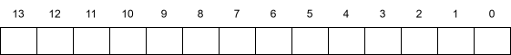
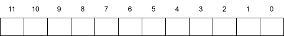
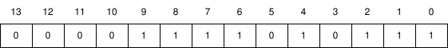
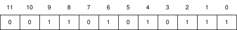

# 第9章 虚拟存储器

## 练习题

### 练习题 9.1

完成下面的表格，填写缺失的条目，并且用适当的整数取代每个问号。
利用下列单位: K=210 (千), M=220(兆,百万), G=230(千兆，十亿)，T=240(万亿)，
P=250(千千兆)，或 E=260(千兆兆)。

|虚拟地址位数(n)|虚拟地址数(N)|最大可能的虚拟地址|
|-|-|-|
|8|||
||2?=64K||
|||232 - 1 = ?G - 1|
||2?=256T||
|64|||

答：

|虚拟地址位数(n)|虚拟地址数(N)|最大可能的虚拟地址|
|-|-|-|
|8|28=256|255|
|16|216=64K|216-1=64K-1|
|32|232=4G|232-1=4G-1|
|48|248=256T|248-1=256T-1|
|64|264=16E|264-1=16E-1|

### 练习题 9.2

确定下列虚拟地址大小(n)和页大小(P)的组合所需要的 PTE 数量:

|n|P=2p|# PTE#
|-|-|-|
|16|4K||
|16|8K||
|32|4K||
|32|8K||

答：

|n|P=2p|# PTE#
|-|-|-|
|16|4K|24=16|
|16|8K|23=8|
|32|4K|220|
|32|8K|219|

### 练习题 9.3

给定一个32位的虚拟地址空间和一个24位的物理地址，对于下面的页面大小P，确定 VPN、VPO、PPN和PPO中的位数:

|P|# VPN位|# VPO位|# PPN位|# PPO位|
|-|-|-|-|-|
|1KB|||||
|2KB|||||
|4KB|||||
|8KB|||||

附录：

<table>
  <thead>
    <tr><th colspan="2">基本参数</th></tr>
    <tr><th>符号</th><th>描述</th></tr>
  </thead>
  <tbody>
    <tr><td>N=2n</td><td>虚拟地址空间中的地址数量</td></tr>
    <tr><td>M=2m</td><td>物理地址空间中的地址数量</td></tr>
    <tr><td>P=2p</td><td>页的大小（字节）</td></tr>
  </tbody>
</table>

<table>
  <thead>
    <tr><th colspan="2">虚拟地址（VA）的组成部分</th></tr>
    <tr><th>符号</th><th>描述</th></tr>
  </thead>
  <tbody>
    <tr><td>VPO</td><td>虚拟页面偏移量（字节）</td></tr>
    <tr><td>VPN</td><td>虚拟页号</td></tr>
    <tr><td>TLBI</td><td>TLB索引</td></tr>
    <tr><td>TLBT</td><td>TLB标记</td></tr>
  </tbody>
</table>

<table>
  <thead>
    <tr><th colspan="2">物理地址（PA）的组成部分</th></tr>
    <tr><th>符号</th><th>描述</th></tr>
  </thead>
  <tbody>
    <tr><td>PPO</td><td>物理页面偏移量（字节）</td></tr>
    <tr><td>PPN</td><td>物理页号</td></tr>
    <tr><td>CO</td><td>缓冲块内的字节偏移量</td></tr>
    <tr><td>CI</td><td>高速缓存索引</td></tr>
    <tr><td>CT</td><td>高速缓存标记</td></tr>
  </tbody>
</table>

**图 9-11 地址翻译符号小结**

答：

|P|# VPN位|# VPO位|# PPN位|# PPO位|
|-|-|-|-|-|
|1KB|22|10|14|10|
|2KB|21|11|13|11|
|4KB|20|12|12|12|
|8KB|19|13|11|13|

### 练习题 9.4

说明 9.6.4 节中的示例存储器系统是如何将一个虚拟地址翻译成一个物理地址和访问缓存的。
对于给定的虚拟地址，指明访问的 TLB 条目、物理地址和返回的高速缓存字节值。
指出是否发生了TLB不命中，是否发生了缺页，以及是否发生了缓存不命中。
如果是缓存不命中，在“返回的缓存字节”栏中输入“-”。
如果有缺页，则在 “PPN”一栏中输入“-”，并且将 C 部分和 D 部分空着。

虚拟地址：0x03d7

A. 虚拟地址格式

B. 地址翻译

|参数|值|
|-|-|
|VPN||
|TLB 索引||
|TLB 标记||
|TLB 命中？（是/否）||
|缺页？（是/否）||
|PPN||

C.

D.

|参数|值|
|-|-|
|字节偏移||
|缓存索引||
|缓存标记||
|缓存命中？（是/否）||
|返回的缓存字节||

A.

B.

|参数|值|
|-|-|
|VPN|0xf|
|TLB 索引|0x3|
|TLB 标记|0x3|
|TLB 命中？（是/否）|是|
|缺页？（是/否）|否|
|PPN|0xd|

C.

D.

|参数|值|
|-|-|
|字节偏移|0x3|
|缓存索引|0x5|
|缓存标记|0xd|
|缓存命中？（是/否）|是|
|返回的缓存字节|0x1d|